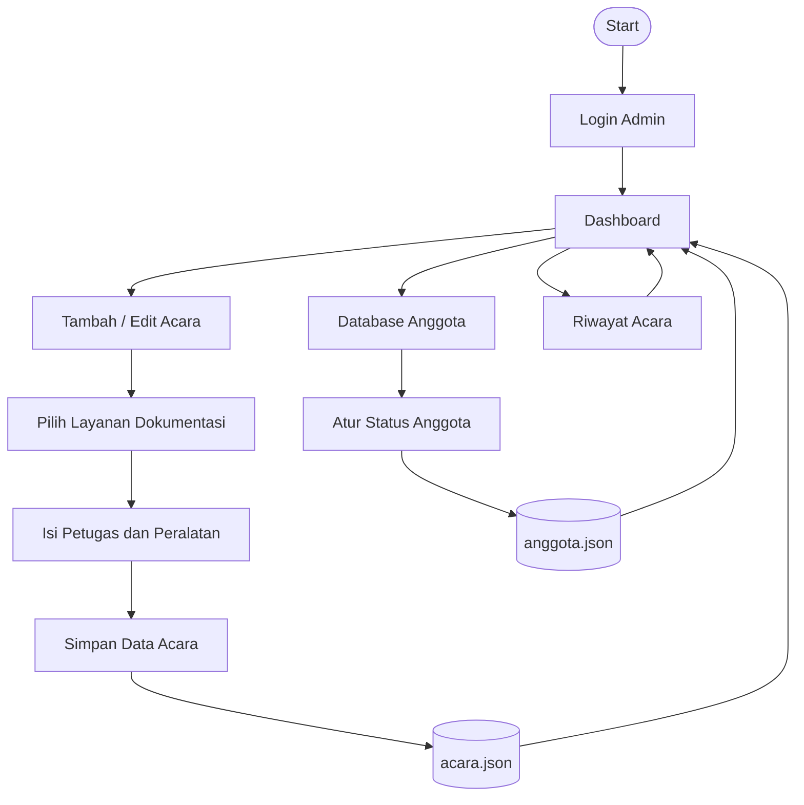

# 🎥 Sistem Pengadaan Dokumentasi Multimedia

<p align="center">
  
</p>

<p align="center">
  
</p>

<p align="center">
  <strong>Aplikasi web untuk mengelola pengajuan kebutuhan dokumentasi acara dan data anggota UPT Multimedia &amp; Public Relation.</strong>
</p>

<p align="center">
  
  
  
  
  
</p>

---

## 📖 About The Project

**Sistem Pengadaan Dokumentasi Multimedia** merupakan aplikasi web berbasis Python dan Flask yang dibuat untuk membantu UPT Multimedia & Public Relation mengelola kebutuhan dokumentasi pada setiap acara kampus.

Aplikasi ini mendukung pendataan acara, pemilihan jenis layanan dokumentasi, pencatatan petugas dan peralatan, serta pengelolaan status anggota. Sistem ini dikembangkan sebagai **Final Project mata kuliah Object-Oriented Programming (OOP)** untuk menerapkan konsep pemrograman berorientasi objek ke dalam sebuah studi kasus.

Data aplikasi disimpan secara lokal menggunakan file **JSON**, sehingga project dapat dijalankan tanpa konfigurasi database server.

---

## ✨ Features

| Fitur | Deskripsi |
|---|---|
| 🔐 **Login Admin** | Autentikasi untuk membatasi akses halaman pengelolaan |
| 📊 **Dashboard** | Menampilkan daftar acara yang telah tercatat |
| ➕ **Tambah Acara** | Mencatat nama acara, tanggal, waktu, dan layanan dokumentasi |
| ✏️ **Edit Acara** | Memperbarui informasi acara, petugas, dan peralatan |
| 🗑️ **Hapus Acara** | Menghapus data acara |
| 🎥 **Multi-Layanan** | Memilih satu atau beberapa layanan dokumentasi dalam satu acara |
| 👥 **Database Anggota** | Menambah, melihat, mengubah status, dan menghapus data anggota |
| 🔄 **Status Anggota** | Mengelompokkan anggota menjadi Kosong, Bertugas, dan Akan Bertugas |
| 📚 **Riwayat Acara** | Melihat daftar acara beserta detail layanan, petugas, dan peralatan |
| 💾 **JSON Storage** | Menyimpan data acara dan anggota ke file JSON |
| ⚠️ **Flash Message** | Menampilkan notifikasi saat proses berhasil atau terjadi kesalahan |

---

## 🎬 Available Documentation Services

Sistem menyediakan lima jenis layanan dokumentasi yang dapat dipilih sesuai kebutuhan acara.

| Layanan | Kegunaan |
|---|---|
| 📸 **Fotografi** | Dokumentasi foto kegiatan |
| 🎥 **Videografi** | Dokumentasi video kegiatan |
| 📡 **Broadcast** | Kebutuhan siaran atau penyiaran acara |
| 🚁 **Drone** | Pengambilan dokumentasi dari udara |
| 📺 **LED** | Kebutuhan tampilan melalui perangkat LED |

Untuk setiap layanan yang dipilih, admin dapat mengisi daftar **petugas** dan **peralatan** yang digunakan.

---

## 🖥️ Application Workflow

Alur penggunaan aplikasi secara umum:



### 1. Login Admin
Admin masuk melalui halaman autentikasi sebelum mengakses fitur pengelolaan.

### 2. Dashboard
Menampilkan acara yang tersimpan beserta label jenis layanan yang digunakan. Dari halaman ini admin dapat menambahkan, mengedit, atau menghapus acara.

### 3. Pengelolaan Acara
Admin mengisi nama acara, tanggal, waktu, serta memilih satu atau beberapa layanan. Ketika jenis layanan dipilih, form detail petugas dan peralatan untuk layanan tersebut akan ditampilkan.

### 4. Database Anggota
Admin dapat menambahkan anggota berdasarkan divisi, memperbarui status tugas, dan menghapus data anggota. Status anggota dikelompokkan ke dalam tiga kategori:

- 🟢 **Kosong** — belum sedang bertugas.
- 🔴 **Bertugas** — sedang bertugas.
- 🟡 **Akan Bertugas** — dijadwalkan untuk bertugas.

### 5. Riwayat Acara
Menampilkan data acara yang telah tersimpan. Baris acara dapat diklik untuk membuka detail layanan, petugas, dan peralatan.

---

## 🧠 Object-Oriented Programming Implementation

Final Project ini menerapkan beberapa konsep utama OOP melalui pemisahan model dan logika aplikasi.

### 1. Abstraction

Class `Layanan` dibuat sebagai abstract base class menggunakan modul `abc`. Class tersebut mendefinisikan method abstrak `ikon()` yang harus diimplementasikan oleh setiap jenis layanan.

### 2. Inheritance

Jenis layanan seperti `Fotografi`, `Videografi`, `Broadcast`, `Drone`, dan `LED` merupakan subclass dari `Layanan`.

### 3. Polymorphism

Setiap subclass memiliki implementasi `ikon()` yang berbeda. Method `ringkasan()` dapat menggunakan method yang sama, tetapi hasil ikon menyesuaikan jenis layanan.

### 4. Encapsulation

Class `Anggota` menyimpan status pada atribut privat `__status`, sedangkan class `Acara` menggunakan atribut privat `__tanggal`. Akses dan validasi dilakukan melalui property.

### 5. Static Method

Class `Acara` memiliki static method `validasi_format_tanggal()` untuk memeriksa format tanggal dengan `datetime.strptime()`.

### 6. Magic Method

Class `Acara` mengimplementasikan `__lt__()` untuk membandingkan tanggal dan waktu, sehingga daftar acara dapat diurutkan secara kronologis.

### 7. Custom Exceptions

Aplikasi mendefinisikan exception khusus:

- `SistemMultimediaError` sebagai base exception.
- `ValidasiError` untuk kesalahan validasi data.
- `AutentikasiError` untuk kesalahan proses login.

---

## 🏗️ Application Architecture

Struktur aplikasi dipisahkan menjadi beberapa bagian agar tanggung jawab tiap file lebih mudah dipahami.

```text
┌───────────────────────────────┐
│       Browser / User          │
└───────────────┬───────────────┘
                │ HTTP Request
                ▼
┌───────────────────────────────┐
│          Flask App            │
│            app.py             │
│  Routing, session, validation │
└───────────────┬───────────────┘
                │
                ▼
┌───────────────────────────────┐
│         OOP Models            │
│           models.py           │
│ Acara, Anggota, Layanan,      │
│ DatabaseManager, Exceptions   │
└───────────────┬───────────────┘
                │
                ▼
┌───────────────────────────────┐
│         JSON Storage          │
│     data/acara.json           │
│     data/anggota.json         │
└───────────────────────────────┘
```

| File | Tanggung Jawab |
|---|---|
| `app.py` | Mengatur route Flask, menerima input form, session login, dan menghubungkan tampilan dengan model |
| `models.py` | Menyimpan class OOP, validasi domain, custom exceptions, serta pengelolaan data JSON |
| `templates/` | Menyediakan halaman HTML berbasis Jinja2 |
| `static/` | Menyimpan CSS, JavaScript, dan logo aplikasi |
| `data/` | Menyimpan data acara dan anggota dalam format JSON; dibuat otomatis saat aplikasi dijalankan |

---

## 🛠️ Tech Stack

<p>
  
  
  
  
  
  
  
</p>

**Dependencies:**

- Flask 3.0.3
- Werkzeug 3.0.3

---

## 📁 Project Structure

```text
FinalProject/
│
├── app.py
├── models.py
├── requirements.txt
├── README.md
│
├── data/                       # Dibuat otomatis saat aplikasi berjalan
│   ├── acara.json
│   └── anggota.json
│
├── templates/
│   ├── base.html
│   ├── login.html
│   ├── dashboard.html
│   ├── tambah_acara.html
│   ├── edit_acara.html
│   ├── database_anggota.html
│   └── riwayat.html
│
└── static/
    ├── css/
    │   └── style.css
    ├── js/
    │   └── main.js
    └── img/
        └── logo.png
```

---

## ⚙️ Installation & Setup

### Prerequisites

Pastikan perangkat sudah memiliki:

- Python 3.8 atau lebih baru.
- pip (Python package manager).
- Git (opsional, untuk clone repository).

### 1. Clone Repository

Clone repository utama:

```bash
git clone https://github.com/herdiansyahdp/OOP_Python_HerdiansyahDwiPutra_462025611083.git
```

Masuk ke folder Final Project:

```bash
cd OOP_Python_HerdiansyahDwiPutra_462025611083/FinalProject
```

### 2. Create Virtual Environment

**Windows PowerShell:**

```powershell
python -m venv .venv
.\.venv\Scripts\Activate.ps1
```

**Linux / macOS:**

```bash
python3 -m venv .venv
source .venv/bin/activate
```

### 3. Install Dependencies

```bash
pip install -r requirements.txt
```

### 4. Run Application

```bash
python app.py
```

Buka browser dan akses alamat lokal berikut:

```text
http://127.0.0.1:5000
```

Saat pertama kali dijalankan, aplikasi akan membuat folder `data/` dan file JSON yang diperlukan apabila belum tersedia.

---

## 🔒 Security Notes

Project ini dibuat untuk kebutuhan pembelajaran dan pengembangan lokal. Sebelum digunakan pada server publik atau lingkungan produksi, beberapa konfigurasi perlu diperbaiki:

- Username dan password admin saat ini masih didefinisikan langsung di `app.py`. Ganti dengan mekanisme autentikasi yang lebih aman.
- `app.secret_key` masih ditulis langsung di source code. Simpan secret key melalui environment variable dan jangan commit nilainya ke repository.
- Nonaktifkan `debug=True` saat deployment.
- Gunakan HTTPS dan praktik keamanan Flask yang sesuai sebelum aplikasi diakses melalui jaringan publik.

**Jangan gunakan konfigurasi autentikasi dan secret key bawaan project untuk deployment produksi.**

---

## 🎯 Project Objectives

Project ini bertujuan untuk:

- Menerapkan konsep OOP dalam studi kasus pengelolaan dokumentasi acara.
- Memahami hubungan antar-class dan pembagian tanggung jawab program.
- Menggunakan Flask untuk menghubungkan model Python dengan antarmuka web.
- Mempraktikkan penyimpanan dan pembacaan data menggunakan JSON.
- Membuat aplikasi dengan proses input, validasi, pengelolaan, dan penyajian data.

---

## 🔭 Future Improvements

Beberapa pengembangan yang dapat dipertimbangkan:

- Menggunakan database relasional seperti SQLite atau MySQL.
- Menambahkan pengelolaan akun dan hak akses pengguna.
- Menyimpan password menggunakan password hashing.
- Menambahkan pencarian dan filter acara.
- Menambahkan laporan statistik dan ekspor data.
- Menambahkan unit test untuk model dan route aplikasi.
- Menyempurnakan validasi jadwal dan penugasan anggota.

---

## 👨‍💻 Author

<p align="center">
  <strong>Herdiansyah Dwi Putra</strong><br/>
  Teknik Informatika
</p>

<p align="center">
  <a href="https://github.com/herdiansyahdp">
    
  </a>
</p>

<p align="center">
  <i>Final Project — Object-Oriented Programming (OOP)</i>
</p>

<p align="center">
  
</p>

---

<p align="center">
  ⭐ <strong>Built to practice OOP and develop a practical campus documentation management system.</strong>
</p>

<p align="center">
  <a href="../README.md">← Back to Main Repository README</a>
</p>
